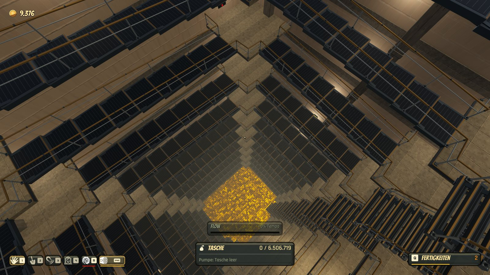
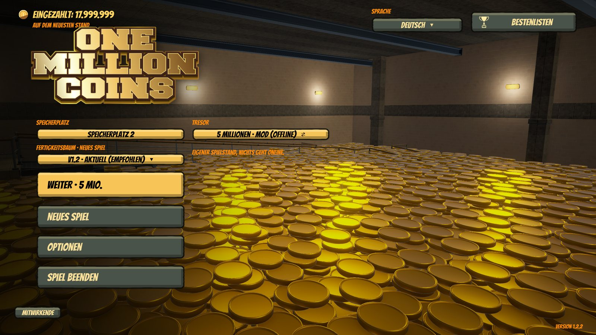
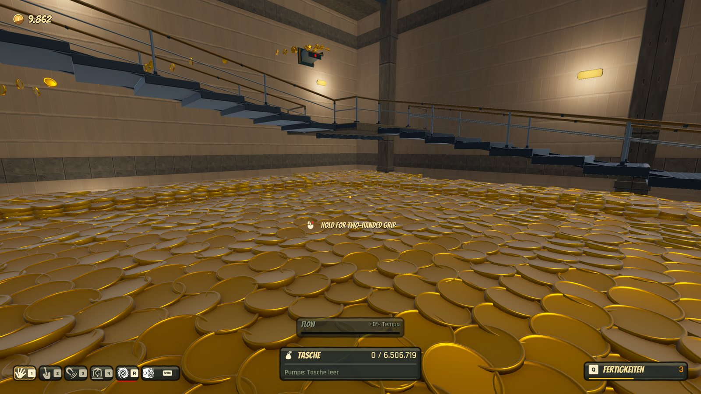
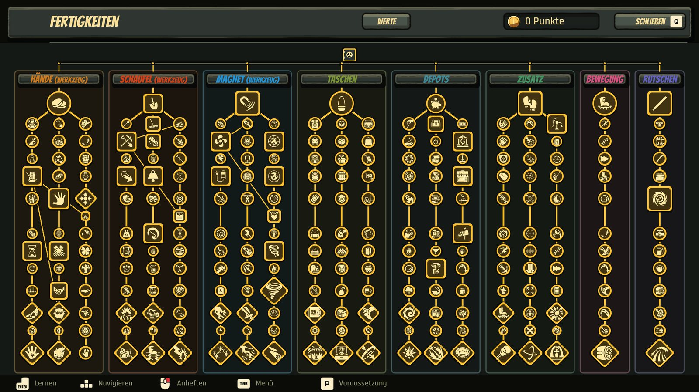
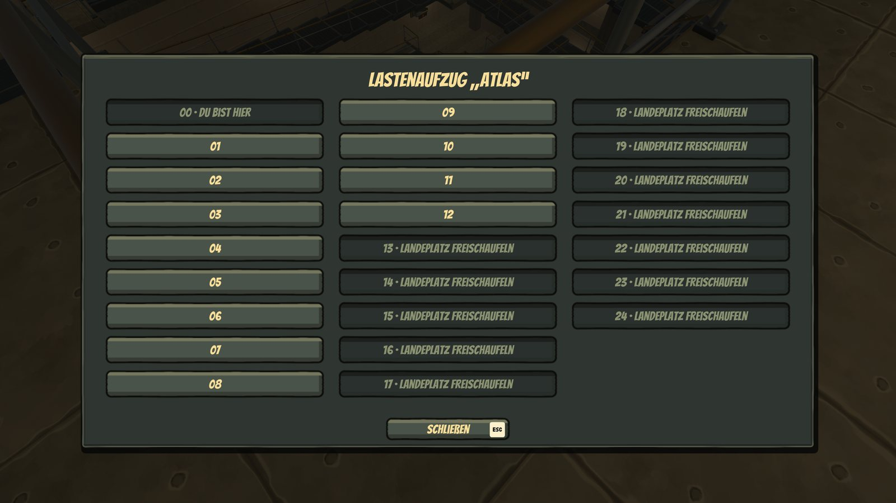
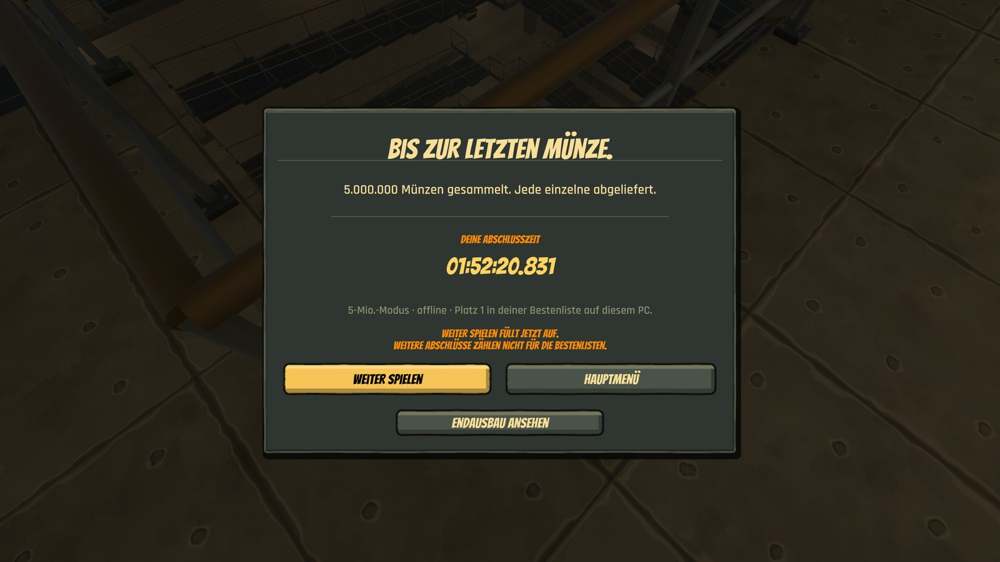
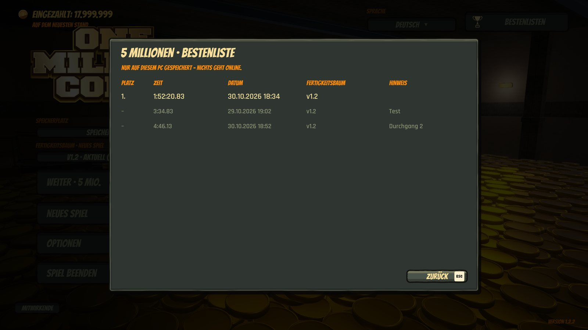

# One Million Coins – „5 Mio. Münzen“ / "5 Million Coins" (Mod)

Inoffizielle Fan-Mod für [One Million Coins](https://store.steampowered.com/app/5258340/) (Steam): ein eigener
Offline-Modus mit einem Tresor aus 25 Etagen und genau **5.000.000 echten Münzen**, einem erweiterten
Fertigkeitsbaum (u. a. Ast „Bewegung“ mit Jetpack), einem schnelleren Aufzug und einer lokalen Bestenliste.
Das normale Spiel mit 1 Million Münzen bleibt unverändert.

*Unofficial fan mod for One Million Coins (Steam): an offline mode of its own with a 25-floor vault holding exactly
**5,000,000 real coins**, an extended skill tree (including a "Movement" branch with a jetpack), a faster elevator
and a local leaderboard. The normal 1 million game is unchanged.*



> **Mit KI geschrieben / written with AI:** Code und Installer entstanden mit Hilfe von Claude (Anthropic), getestet
> im Spiel und mit automatischen Prüfläufen. Die Mod stammt nicht vom Entwickler des Spiels und wird von ihm nicht
> unterstützt. Nutzung auf eigene Gefahr. / *Code and installer were written with the help of Claude (Anthropic) and
> tested in the game and with automated test runs. Not made or supported by the game's developer. Use at your own risk.*

## Download und Installation / Download and install

1. Unter **[Releases](https://github.com/Bl4ck969/OneMillionCoins-5Mio/releases)** oder auf
   **[Nexus Mods](https://www.nexusmods.com/onemillioncoins/mods/4)** die ZIP-Datei laden und entpacken. / *Download and
   unpack the ZIP from **Releases** or **Nexus Mods**.*
2. Spiel beenden, `OMC-5Mio-Installer.exe` starten, „Installieren …“. / *Quit the game, run the installer, "Install …".*
3. Im Hauptmenü des Spiels die Auswahl **Tresor** auf „5 Millionen · Mod (offline)“ stellen. / *In the main menu,
   switch **Vault** to "5 million · mod (offline)".*

Update: den neuen Installer starten, „Neu installieren …“ – Spielstände, Bestenliste und Einstellungen bleiben. /
*Updating: run the new installer, "Reinstall …" – saves, leaderboard and settings are kept.*

Ohne Installer: `OMC-5Mio-<Version>-manuell.zip` enthält nur die Mod-DLL; dazu
[BepInEx 5.4.23.6 x64](https://github.com/BepInEx/BepInEx/releases/tag/v5.4.23.6) selbst installieren, Anleitung im
Paket. / *Without the installer: `…-manuell.zip` holds only the mod DLL; install BepInEx 5.4.23.6 x64 yourself,
instructions inside.*

Voraussetzung: Windows 10/11 64 Bit. Geprüft mit Spielversion **1.2.2** (Steam-Build 26290693 und 26367772 vom
03.11.2026). Nach einem Spiel-Update bleibt die Mod zunächst aus; im Hauptmenü unten links lässt sie sich mit
„Trotzdem einschalten …“ für genau diese Version einschalten, auf eigene Gefahr. Deinstallieren über denselben
Installer stellt den Originalzustand her. Details in der `LIESMICH.txt` im Download. / *Requires Windows 10/11 64-bit.
Tested with game version **1.2.2** (Steam builds 26290693 and 26367772 of 3 Nov 2026). After a game update the mod
stays off at first; "Switch on anyway …" at the bottom left of the main menu turns it on for exactly that version,
at your own risk. Uninstalling with the same installer restores the original state. Details in `LIESMICH.txt`.*

**Offline:** Der 5-Mio.-Modus sendet nichts an Steam (keine Bestenlisten, Erfolge oder Steam Cloud) und hat einen
eigenen Spielstand unter `%LOCALAPPDATA%\OneMillionCoins-5Mio\`. / *The 5 million mode sends nothing to Steam and
keeps its own save.*

Lizenz / License: [MIT](LICENSE). Mitgeliefert / bundled: BepInEx 5.4.23.6 und Bestandteile, siehe
[Drittanbieter.txt](installer/pakete/Drittanbieter.txt).

## Bilder / Screenshots

| | |
|---|---|
| <br>Hauptmenü: Tresor „5 Millionen · Mod (offline)“ / *Main menu: vault "5 million"* | <br>Auf dem Haufen in Etage 12 / *On the pile on floor 12* |
| <br>Voller Fertigkeitsbaum mit dem Ast „Bewegung“ / *Full skill tree with the "Movement" branch* | <br>Aufzug mit 25 Etagen, gesperrte nennen den Grund / *Elevator with 25 floors, locked ones show why* |
| <br>Abschluss: 5.000.000 Münzen, Platz in der lokalen Bestenliste / *Finish: 5,000,000 coins, rank in the local leaderboard* | <br>Bestenliste nur auf diesem PC / *Leaderboard stored on this PC only* |

---

## Entwicklung

BepInEx-5-Plugin `OneMillionCoins5Mio` (Unity 6000.6, Mono, .NET Framework 4.7.2). Arbeitsnotizen mit Stand,
Entscheidungen, Prüfverfahren und Lehren: [ERKENNTNISSE.md](ERKENNTNISSE.md).

- **Gebäude:** wird zur Laufzeit aus den Bauteilen des Originals neu aufgebaut: 25 Etagen (4,2 → 14,12 m),
  genau 5.000.000 Münzen; die letzte liegt wie im Original am Ende in der Kiste.
- **Leistung:** beim Abgraben ~70 FPS (Original 67–88 FPS unter gleicher Last).
- **Spielstand:** eigener Mod-Spielstand in `%LOCALAPPDATA%\OneMillionCoins-5Mio\`, gespeichert beim Verlassen
  über das Pausemenü. Der echte Spielstand wird nie angefasst.
- **Aufzug:** fährt in 1,5 s an, dann gleichmäßig mit 7 m/s (einstellbar unter `[Aufzug]`). Kabinentasten: `00`, `MENU`
  (alle Etagen), zwei und eine Etage höher, zwei und eine tiefer – jeweils von der aktuellen Etage aus.
  Gesperrte Etagen nennen im Aufzugsmenü den Grund.
- **Bestenliste:** nur lokal; bei Tresor „5 Millionen“ zeigt „Bestenlisten“ die eigenen Läufe.
- **Fertigkeiten:** Start bei null; Goldfluss/Filialleiter +300 %, Bankradius 15 m, [4] holt die Taschenbank zurück,
  Ast „Bewegung“ mit Jetpack, Einzahlautomaten in Gruppen über „Unterer Trichter“. Testmodus mit allen Fertigkeiten nur in
  Prüfläufen (eigener Test-Spielstand).
- **Sprache:** Texte der Mod auf Deutsch oder Englisch nach Spielsprache.
- **Versionsschutz:** Läuft das Spiel in einer nicht geprüften Version (nach einem Steam-Update), setzt die Mod
  zunächst keinen Patch und zeigt im Hauptmenü einen Hinweis mit „Trotzdem einschalten …“. Die Freigabe gilt nur für
  genau diesen Stand (`[Kompatibilitaet] FreigegebeneVersion`, Kennung aus den Prüfsummen) und ab dem nächsten Start;
  der Installer fragt bei einer ungeprüften Version ebenso. Scheitert das Patchen auf einem fremden Stand, nimmt die Mod
  alle Patches zurück. Das Spiel zählt seine Versionsnummer nicht bei jedem Update hoch – unterschieden wird am
  Steam-Build und an den Prüfsummen.
- **Spielstände** der Vorversion laden weiter (geprüft 03.11.2026 mit einem Spielstand von Mod 1.0.0, Prüfmodus
  `spielstand-laden`).
- **Bekannt:** einzelne Stellen ohne Kollision (87 von 722.298 Prüfpunkten: ein Handlaufstab und ein Gitterfuß auf
  Etage 22/23).

### Offline-Schutz

Alle Eingriffe greifen nur im Mod-Modus. Im normalen Spiel ändert der Mod nichts.

- Spielstand nur im eigenen Mod-Ordner unter `AppData\Local` – nicht unter `LocalLow`, das Steam Cloud
  hochlädt. Jeder Zugriff außerhalb des Mod-Ordners wird abgebrochen. Keine Lifetime-Coins, kein Banking.
- Die Logzeilen des Mods stehen nur in `BepInEx\LogOutput.log`, nicht in `Player.log` (wird von Steam Cloud hochgeladen).
- Gesperrt sind Speedrun- und Sammler-Bestenliste, Achievements, Steam-Statistiken und Steam Cloud.
  Gesperrt wird in der Spiel-Logik und zusätzlich direkt an Steamworks.NET.
- Fehlt beim Start eine Pflicht-Sperre, erscheint der Menü-Eintrag nicht.
- Das Spiel selbst markiert den Lauf als „nicht gewertet“ (Testausrüstung).
- Laut Steam-Store hat das Spiel keinen Anti-Cheat (VAC), geprüft am 25.10.2026.

### Bauen und prüfen

```bash
dotnet build OneMillionCoins5Mio.csproj -c Release
```

Das kopiert die DLL nach `<Spiel>\BepInEx\plugins\OneMillionCoins5Mio\` (`-p:Deploy=false`: nur bauen). Der
Spielpfad lässt sich über `-p:GamePath=...` ändern.

Prüfaufnahme (startet das Spiel selbst und beendet es wieder; **nicht während des Spielens**):

```powershell
.\werkzeuge\pruefung.ps1 -Modus mod
```

Weitere Modi: `original`, `inventar`, `leistung`, `leistung-original`, `spielstand`, `spielstand-laden`, `fertigkeiten`,
`versionsschutz`, `versionsschutz-fehler`, `bilder` (Aufnahmen für dieses README; Beschreibung in ERKENNTNISSE.md,
Abschnitt 7). Die Testläufe steuern die Spielfigur selbst. Nach einem Spiel-Update laufen sie mit
`[Kompatibilitaet] UngepruefteVersion = true` (Ablauf in ERKENNTNISSE.md, Abschnitt 9).

Einstellungen: `<Spiel>\BepInEx\config\de.bl4ck969.onemillioncoins.5mio.cfg`, Erläuterung in ERKENNTNISSE.md.

### Installer und Release

```powershell
python -I werkzeuge\release.py
```

Baut Plugin (ohne Kopie ins Spiel) und Installer, fährt `werkzeuge\installer_test.py` (11 Fälle an nachgebauten
Spielordnern) und legt `release\OMC-5Mio-<Version>.zip` an (Installer, LIESMICH de/en, Lizenzen, SHA-256).

- Der Installer findet das Spiel über Steam, prüft die Spielversion gegen die geprüften Stände in `src\ReleaseInfo.cs`
  und ob das Spiel läuft, zeigt den Hinweis zur Mod und installiert erst nach Zustimmung. Bei einer ungeprüften Version
  fragt er: installieren und einschalten / installieren, aber aus lassen / abbrechen (Kommandozeile: `--ungeprueft`).
- Er bringt BepInEx 5.4.23.6 mit (nur, wenn noch keins da ist), sichert jede Datei, die er überschreiben müsste, und
  protokolliert alles in `<Spiel>\5Mio-Mod-Installation\`.
- **Deinstallieren** im selben Programm stellt den Zustand vor der Installation her, fragt, ob die Mod-Spielstände
  mitgelöscht werden, und vergleicht den Spielordner danach mit Steams Dateiliste.

### BepInEx von Hand (Entwicklung)

BepInEx 5.4.23.6 win_x64 (SHA-256 `6c57a714…0755`). Ins Spielverzeichnis kopiert:
`BepInEx\`, `winhttp.dll`, `doorstop_config.ini`, `.doorstop_version`.
**Entfernen:** genau diese vier Einträge löschen, danach ist das Spiel wie vorher.
